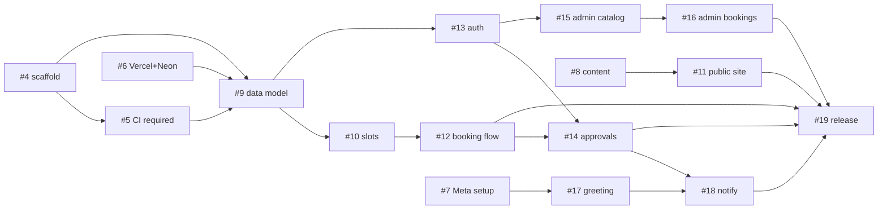

# Delivery Plan

How we build [design-plan.md](design-plan.md), phase by phase. **GitHub is the tracker:** one milestone per phase, one issue per deliverable. Work the issues in order; the issue's checklist is the definition of done.

- Milestones: <https://github.com/himanshurai899/Barber-HairSalon-App/milestones>
- Issues: <https://github.com/himanshurai899/Barber-HairSalon-App/issues>
- Branch and PR rules: [CONTRIBUTING.md](../CONTRIBUTING.md)

## How we use the tracker

| Thing | Rule |
|---|---|
| Milestone | One per phase. A phase is done when all its issues are closed |
| Issue | One deliverable = one branch = one PR. Has branch name, test style and a "Done when" checklist |
| Labels | `phase-N`, area (`public-site`, `admin`, `staff`, `whatsapp`, `database`, `infra`), `tdd` or `minor`, `owner-task` |
| `tdd` | Major feature. Failing test first, then code, then refactor. PR shows the tests |
| `minor` | Cosmetic or non-breaking. Lint + build + manual check at 390px and desktop |
| `owner-task` | Needs the salon owner (accounts, content, decisions). Not code |
| PR | Targets `develop`, body says `Closes #N`, needs owner approval (ruleset) and green CI |
| Order | Within a phase follow the table below; phases overlap only for `owner-task` items |
| New work | Open an issue first, put it in a milestone, or in "Later" below |

## Phases

**Progress (code):** #5, #9-#18 are merged to `develop`. Open: #6, #7, #8 (owner tasks) and #19 (release, needs them). WhatsApp code is tested against a mocked Cloud API only; it has not talked to Meta.

### Phase 0 · Foundation
Goal: everything needed so feature work can start and hosting/WhatsApp lead times begin early.

| Issue | Deliverable | Kind | Branch |
|---|---|---|---|
| #4 | Project scaffold (PR #2) | minor | `chore/scaffold` |
| #5 | Require CI check on main and develop | minor | `chore/require-ci` |
| #6 | Link Vercel project and Neon database | owner-task | n/a |
| #7 | Start Meta WhatsApp Business setup | owner-task | n/a |
| #8 | Collect salon content, answer open questions | owner-task | n/a |

Exit: CI green on `develop`, preview URL live, Meta approval in progress, content received.

### Phase 1 · Core booking
Goal: a customer can request a slot on the website and see its status.

| Issue | Deliverable | Kind | Branch |
|---|---|---|---|
| #9 | Data model and no-overlap constraint | tdd | `feature/data-model` |
| #10 | Slot engine | tdd | `feature/slot-engine` |
| #11 | Public site: landing, services, privacy | minor | `feature/public-site` |
| #12 | Customer booking flow | tdd | `feature/booking-flow` |

Exit: on the preview URL, book a slot, see it pending, cancel it; two people cannot take the same slot.

### Phase 2 · Staff and admin
Goal: barbers approve bookings; admin runs the shop without a developer.

| Issue | Deliverable | Kind | Branch |
|---|---|---|---|
| #13 | Barber and admin login with roles | tdd | `feature/staff-auth` |
| #14 | Barber approvals and schedule | tdd | `feature/staff-approvals` |
| #15 | Admin: barbers, services and hours | minor/mixed | `feature/admin-catalog` |
| #16 | Admin: bookings, manual bookings, notices, settings | mixed | `feature/admin-bookings` |

Exit: the full loop works on preview: customer books → barber approves → customer sees approved; admin adds a phone booking, a Navratri special-hours range and a barber's time off.

### Phase 3 · WhatsApp
Goal: WhatsApp is a booking channel. Needs #7 approved.

| Issue | Deliverable | Kind | Branch |
|---|---|---|---|
| #17 | Webhook: greeting with booking link | tdd | `feature/whatsapp-greeting` |
| #18 | Notifications: barber alert, confirm, decline | tdd | `feature/whatsapp-notify` |

Exit: texting the salon number returns the greeting and link once per 24h; barber gets an alert; customer gets confirm or decline.

### Phase 4 · Launch
| Issue | Deliverable | Kind | Branch |
|---|---|---|---|
| #19 | Release 0.1.0 and go-live | minor | `release/0.1.0` |

Exit: custom domain live, one test booking through each channel, `v0.1.0` tagged on `main`.

## Dependencies

## Risks to watch

| Risk | Mitigation |
|---|---|
| Meta business verification and template approval take days | #7 starts in Phase 0 |
| Salon content arrives late | Build public site with placeholders, swap content before launch |
| Vercel Hobby cannot host a business site | Pro plan decision in #6 |
| WhatsApp send fails | Never roll back a booking; log and show in admin (#18) |
| Spam bookings | Honeypot, per-phone limit, barber approval (#12) |
| Owner is the only reviewer | Keep PRs small, one issue each |

## Admin CRUD matrix

Every action checks the admin role itself (`requireRole`); barbers never reach these pages. Hard deletes always go through a confirm page.

| Thing | Create | Read | Update | Delete |
|---|---|---|---|---|
| Services | yes | yes | yes | confirm page; blocked with a count when bookings use it (hide it instead) |
| Barbers | yes | yes | yes (profile, services, weekly availability) | confirm page; blocked when bookings exist; availability, links, time off go with it |
| Time off | yes | yes | yes | yes |
| Special hours | yes | yes | yes | yes |
| Weekly shop hours | single set, edit only | yes | yes | n/a by design |
| Shop settings | single row, edit only | yes | yes | n/a by design |
| Notices and offers | yes | yes | yes | yes |
| Bookings | manual (phone, walk-in) | yes | edit time, barber, services, note, customer (slot engine, overlap rule); status override | confirm page, admin only |
| Clients | yes (also auto-created by bookings) | search, detail, history | yes (name, phone, email, notes, WhatsApp opt-in) | confirm page; blocked while they have bookings |
| Staff logins | yes | yes | name, role, barber profile; reset password | confirm page; never yourself or the last admin |
| Own password | n/a | n/a | any signed-in user, `/account/password` | n/a |

Phone numbers are normalised to E.164 (`src/lib/phone.ts`); one number is one client, and one number belongs to at most one barber.

## Later (no issue until wanted)
Reminder template the day before · `.ics` add-to-calendar · gallery · Hindi/Gujarati copy · missed-call → WhatsApp link · deposits (Razorpay/Stripe) · reports · sending notices from the app to opted-in customers.
