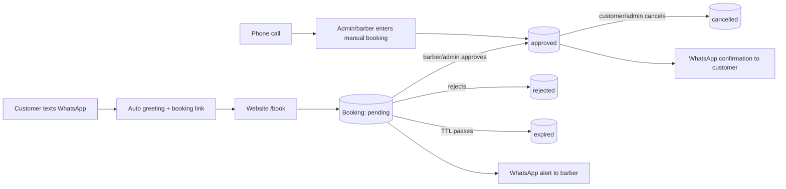
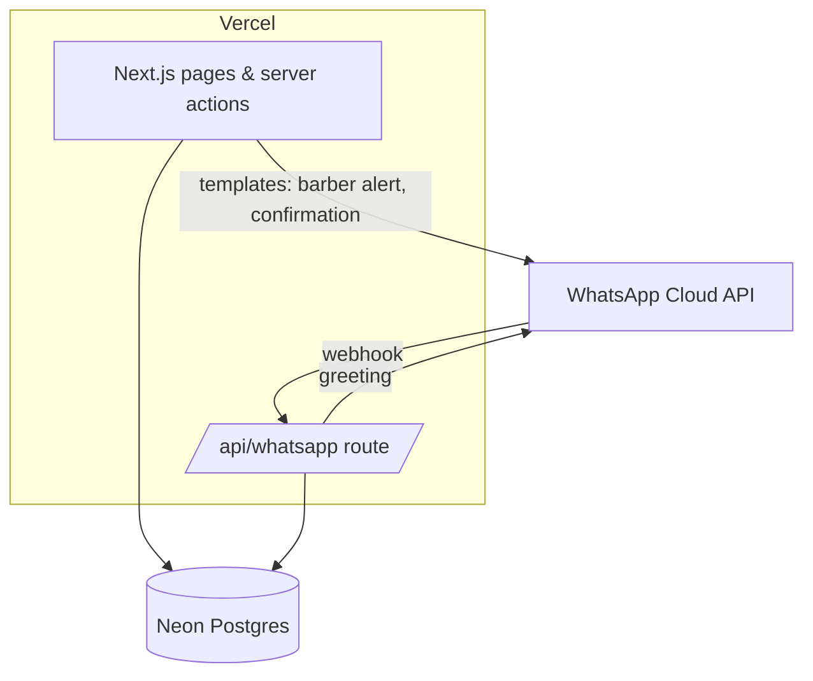
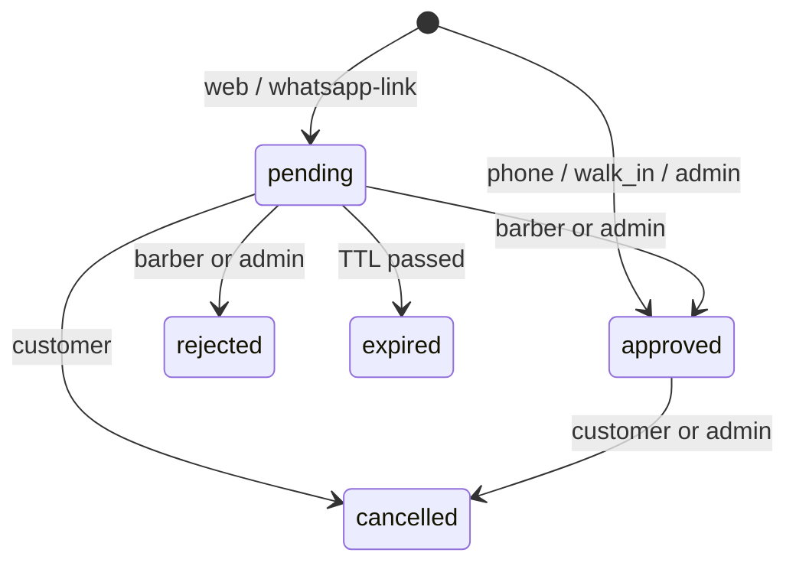

# Hair Salon Booking — Design Plan

Status: **Draft v0.1** · 2026-10-25 · Research notes: [research.md](research.md)

## 1. Goals

1. Take bookings from **website, WhatsApp and phone calls** into one calendar.
2. Every booking is **approved by a barber** (or admin) before it's confirmed.
3. Anyone who messages the business WhatsApp gets an **automatic greeting + booking link**.
4. Landing page shows **name, address, location sharing and current offers**.
5. **Mobile-first**, responsive, minimal and quiet UI.
6. **Admin pages** control barbers, services, hours, offers, bookings and shop settings.
7. Hosted on **Vercel**, cheap to run, boring to maintain.

**Non-goals for v1** (add when asked): online payments/deposits, customer accounts, loyalty, multi-branch, IVR/telephony automation, chatbot conversations, inventory, payroll.

## 2. Roles

| Role | Can do | Login |
|---|---|---|
| Customer | View site, request booking, view/cancel own booking via private link | None (name + phone) |
| Barber | See own requests, approve/reject, see own schedule | Email + password, created by admin |
| Admin | Everything: barbers, services, working hours, time off, offers, settings, any booking, manual bookings | Email + password |

## 3. Booking channels



- **Website** — the single booking flow; every other channel funnels into it.
- **WhatsApp** — webhook replies once per 24 h per number with a greeting and a "Book a slot" button (CTA-URL interactive message). Humans keep chatting from the WhatsApp Business app via *coexistence* (see research).
- **Call** — `tel:` button everywhere. Staff create the booking in admin; source = `phone`, status = `approved` directly (a human already agreed to it on the call). Walk-ins use the same form (source = `walk_in`).

## 4. Sitemap

**Public** (mobile-first)

| Route | Content |
|---|---|
| `/` | Hero (name, one line, *Book* + *WhatsApp*), open-now badge, **offers**, top services, barbers, **Visit** block (address, map, *Directions*, *Share location*, hours), footer |
| `/services` | All services with duration and price, grouped by category |
| `/book` | Step flow: service → barber (default *Any available*) → date + time → name/phone → review. Step state lives in URL params (no PII), so back button works |
| `/b/[token]` | Booking status (pending / approved / …), details, *Cancel*, *Get directions* |
| `/privacy` | Required by Meta for WhatsApp + general |

Sticky bottom bar on phones: **Book · WhatsApp · Call**.

**Staff** — `/staff`: pending requests (oldest first, approve/reject with optional reason), today + upcoming schedule.

**Admin** — `/admin`:
`dashboard` (today, pending count) · `bookings` (filter, manual booking, override status) · `barbers` (profile, photo, services offered, login link) · `hours` (weekly rules per barber, breaks, time off) · `services` · `offers` (title, text, valid from/to) · `settings` (shop name, address, lat/lng, phone, WhatsApp number, greeting text, timezone, booking rules) · `users`.

## 5. Visual design

Quiet, warm, editorial. Nothing flashes, slides or autoplays.

| Token | Light | Use |
|---|---|---|
| `--bg` | `#FAF8F5` | page (warm paper) |
| `--surface` | `#FFFFFF` | cards, sheets |
| `--ink` | `#1C1C1A` | text, primary button |
| `--muted` | `#6B6862` | secondary text |
| `--line` | `#E7E3DC` | 1px borders, dividers |
| `--accent` | `#8A6F4E` | one muted leather tone: links, selected slot, offer badge |
| `--ok` / `--warn` | `#3F6B4E` / `#9A5B2E` | status pills only |

Dark tokens are defined from day one (same names) so admin works at night; public site ships light-first.

- **Type**: Inter for everything; one serif (Fraunces) for H1/H2 only. Base 16px (stops iOS zoom on inputs), 1.5 line-height.
- **Shape**: radius 10px, 1px borders, no drop shadows except bottom sheets.
- **Motion**: ≤150 ms opacity/translate; disabled under `prefers-reduced-motion`.
- **Touch**: targets ≥ 44px, primary actions in thumb zone, one primary button per screen.
- **Layout**: design at 360px, enhance at 768px and 1024px. Max content width 72ch for text.
- **Images**: one consistent crop/filter, `next/image`, no hero video.
- **Accessibility**: WCAG AA contrast, visible focus rings, labels on every input, slots are real buttons.
- **SEO**: `HairSalon` JSON-LD (name, address, geo, hours, phone), per-page metadata, OG image.

### Location sharing

- *Directions*: `https://www.google.com/maps/search/?api=1&query=<lat>,<lng>` (or place id).
- *Share location*: Web Share API (`navigator.share`) with the maps URL; fallback copies link + opens `wa.me/?text=`.
- Map: Google Maps Embed iframe, `loading="lazy"`.

## 6. Tech stack

| Concern | Choice | Why |
|---|---|---|
| Framework | **Next.js (App Router) + TypeScript** | Native on Vercel; server components + server actions = no separate API |
| Styling | **Tailwind CSS v4**; shadcn/ui only for admin primitives (dialog, table) | Tokens in CSS, components copied into repo, no runtime UI lib |
| Database | **Neon Postgres** via Vercel Marketplace | Serverless Postgres, free tier, preview branch per PR |
| ORM / migrations | **Drizzle ORM + drizzle-kit** | Thin, SQL-shaped, typed, plain SQL migrations in git |
| Auth | **Better Auth** (email + password, `role` field) | Sessions/hashing done for us, Drizzle adapter, no external IdP |
| Validation | **Zod** | One schema for forms + server actions |
| Phone numbers | **libphonenumber-js** (min) | Normalise to E.164 — phone is the customer key |
| Messaging | **WhatsApp Cloud API** (direct `fetch`, no SDK) | Official, ~3 endpoints used |
| Unit/integration tests | **Vitest + PGlite** (`btree_gist` included) | Real Postgres constraints in-process, no Docker |
| E2E | **Playwright** (mobile viewport first) | Smoke-tests booking + approval |
| CI | **GitHub Actions**: lint, typecheck, test on every PR | |
| Package manager | **pnpm** | |

**Hosting note:** Vercel *Hobby* is for non-commercial use only — a salon site needs **Vercel Pro** in production. Neon free tier is enough to start.

## 7. Architecture



```
src/
  app/
    (public)/           page.tsx, services/, book/, b/[token]/, privacy/
    staff/              barber pages
    admin/              admin pages
    api/whatsapp/route.ts
  lib/
    db/schema.ts        Drizzle schema (single file)
    slots.ts            pure slot engine
    bookings.ts         create / transition bookings
    whatsapp.ts         send + verify signature
    auth.ts
tests/e2e/
drizzle/                generated SQL migrations
```

No separate backend, no queue, no cache layer. Add only when a measured need appears.

## 8. Data model

```
shop_settings   (single row) name, tagline, address, lat, lng, maps_place_id, phone,
                whatsapp_number, timezone, currency, greeting_text, pending_ttl_min,
                slot_step_min, min_notice_min, horizon_days, max_open_per_phone
shop_hours      weekday, opens, closes                 -- display + outer bound
barbers         id, name, phone, photo_url, bio, active, sort, user_id?
services        id, name, category, duration_min, price_minor, active, sort
barber_services barber_id, service_id                  -- who does what
availability    id, barber_id, weekday, start_time, end_time   -- many rows/day = breaks
time_off        id, barber_id, during tstzrange, reason
customers       id, phone (E.164, unique), name, wa_opt_in, created_at
bookings        id, customer_id, barber_id, service_id, during tstzrange,
                status, source, note, manage_token (unique), price_minor,
                decided_by?, decided_at?, decision_note?, created_at
offers          id, title, body, badge, starts_on, ends_on, active, sort
wa_inbound      wa_message_id (pk), from_phone, received_at   -- dedupe + greet-once
user / session / account   -- Better Auth tables, user.role in ('admin','barber')
```

Money in minor units (paise/cents). All times `timestamptz`; shop timezone converts at the edges. Price copied onto the booking so later price edits don't rewrite history.

**The rule that matters — no double booking, enforced by the database:**

```sql
CREATE EXTENSION IF NOT EXISTS btree_gist;
ALTER TABLE bookings ADD CONSTRAINT no_overlap
  EXCLUDE USING gist (barber_id WITH =, during WITH &&)
  WHERE (status IN ('pending', 'approved'));
```

Pending bookings hold the slot, so two customers can't request the same time.

### Booking lifecycle



`source` ∈ `web | whatsapp | phone | walk_in | admin`. Transitions live in one function (`transition(booking, to, actor)`) with a table of allowed moves — illegal moves throw.

**Expiry without a cron:** before reading slots or inserting, run `UPDATE bookings SET status='expired' WHERE status='pending' AND created_at < now() - ttl`. Correct on every request, and avoids Vercel Cron limits.

## 9. Slot engine (`lib/slots.ts`)

Pure function, no I/O — the main TDD target:

```
getSlots({ date, service, barbers, availability, timeOff, bookings, settings, now }) → [{ start, barberIds[] }]
```

1. For each barber who offers the service: working windows for that weekday ∩ shop hours.
2. Subtract time off and blocking bookings (pending + approved).
3. Walk each free window in `slot_step_min` steps; keep starts where `start + duration` fits.
4. Drop starts before `now + min_notice_min` and beyond `horizon_days`.
5. *Any available*: union across barbers; on submit pick the barber with the fewest bookings that day (tie → sort order).

Edge cases covered by tests: DST/timezone boundaries, service longer than window, back-to-back bookings, break in the middle of the day, barber inactive, booking ending exactly at slot start (ranges are `[)`).

## 10. WhatsApp integration

**Inbound greeting** — `POST /api/whatsapp`
1. Verify `X-Hub-Signature-256` (HMAC-SHA256 of raw body with app secret). Reject otherwise.
2. For each message: `INSERT INTO wa_inbound … ON CONFLICT DO NOTHING`; skip if duplicate.
3. If this number got no greeting in the last 24 h → send interactive `cta_url` message: greeting text from settings + **Book a slot** button → `/book?src=wa`.
4. Upsert customer by phone (name from WhatsApp profile). Always return 200 fast.

`GET /api/whatsapp` handles Meta's verify-token handshake.

**Outbound templates** (utility category, pre-approved in Meta Business Manager):

| Template | To | When |
|---|---|---|
| `booking_request_barber` | barber | new pending booking — includes link to `/staff` |
| `booking_confirmed` | customer | approved |
| `booking_declined` | customer | rejected (with optional reason) |

Customers only get templates if they ticked "Send updates on WhatsApp" (default on, required consent). Sending is fire-and-forget after the DB commit; a failure is logged and shown in admin, never rolls back the booking.

Cost: greetings fit in Meta's 1,000 free service messages/month per number; templates are billed per message (see research).

## 11. Security & abuse

- Role check inside **every** server action, not only in layout/middleware.
- Zod validation on every input; server is the source of truth for prices and durations.
- Webhook signature verification; secrets only in Vercel env vars.
- Booking spam: honeypot field, `max_open_per_phone` (default 2 pending/approved future bookings), Vercel Firewall rate limit on `/book` actions. Barber approval is the final filter.
- `manage_token` = 128-bit random, the only way to see a booking without login. Never put phone/name in URLs.
- Later, if fake numbers become a problem: WhatsApp OTP (authentication template).

## 12. Testing strategy

| Area | Approach |
|---|---|
| Slot engine, booking transitions, overlap constraint, webhook handler, signature check, notifications | **TDD** — failing test first (Vitest; PGlite for DB) |
| Booking flow + approval | Playwright E2E at 390×844, plus one desktop run |
| Landing/services/visual tweaks, copy, styles | Build + manual check on phone width + lint; no new tests required |

CI blocks merge on lint, typecheck and tests.

## 13. Environments & config

| Env | Branch | DB | URL |
|---|---|---|---|
| Local | any | Neon dev branch (or local Postgres) | localhost:3000 |
| Preview | every PR / `develop` | Neon branch per preview (Vercel integration) | Vercel preview URL |
| Production | `main` | Neon main | custom domain |

Env vars: `DATABASE_URL`, `BETTER_AUTH_SECRET`, `BETTER_AUTH_URL`, `WA_PHONE_NUMBER_ID`, `WA_ACCESS_TOKEN`, `WA_APP_SECRET`, `WA_VERIFY_TOKEN`, `NEXT_PUBLIC_MAPS_EMBED_KEY`. Template list: `.env.example`.

## 14. Roadmap

Each line is one branch off `develop` (see [CONTRIBUTING.md](../CONTRIBUTING.md)).

| # | Branch | Kind | Done when |
|---|---|---|---|
| 0 | `chore/scaffold` | setup | Next.js + Tailwind + Drizzle + Vitest + Playwright + CI green, deploys to Vercel preview |
| 1 | `feature/data-model` | TDD | Schema + migrations; overlap constraint test passes |
| 2 | `feature/slot-engine` | TDD | `getSlots` spec cases pass |
| 3 | `feature/public-site` | minor | Landing (offers, visit, share location), services, privacy |
| 4 | `feature/booking-flow` | TDD | `/book` → pending booking → `/b/[token]`, cancel works |
| 5 | `feature/staff-auth` | TDD | Login, roles, `/staff` approve/reject |
| 6 | `feature/admin` | mixed | CRUD for barbers, services, hours, time off, offers, settings, manual booking |
| 7 | `feature/whatsapp-greeting` | TDD | Webhook verified, dedupe, greet-once-per-24h |
| 8 | `feature/whatsapp-notify` | TDD | Barber alert + customer confirm/decline templates |
| — | `release/0.1.0` | release | E2E green on preview, merged to `main`, tagged |

Later candidates: reminder template the day before, `.ics` add-to-calendar, gallery (Vercel Blob), Hindi/regional language, missed-call → WhatsApp link (Exotel/Twilio), deposits (Razorpay/Stripe), reports.

## 15. Assumptions & open questions

Defaults used until answered:

1. **"Admin will approve the time slots"** — read as: admin publishes each barber's working hours/time off (which slots exist); barbers approve individual bookings; admin can approve/override any. *Confirm, or should admin approve every booking too?*
2. Single shop, one location.
3. India defaults: `+91`, INR, `Asia/Kolkata` — all editable in settings.
4. Pending TTL **2 hours**; shown to customer ("we'll confirm within 2 hours").
5. Existing WhatsApp Business app number will be connected via coexistence (needs Meta Business verification + payment method).
6. English only in v1.
7. No payments in v1.
